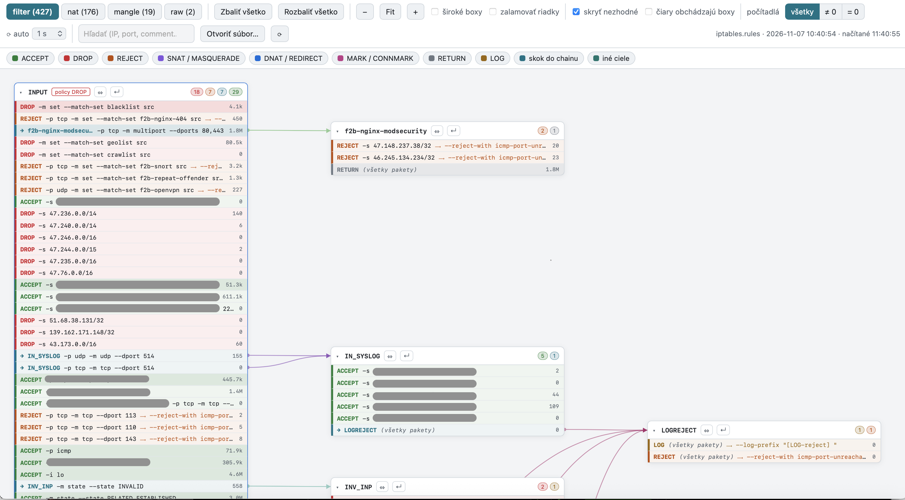

# iptables-map (iptables aj nftables)

Mapa pravidiel firewallu z `iptables-save` alebo `nft list ruleset` (formát sa rozpozná automaticky): každý chain je box, čiary vedú z pravidla (skok -j/-g)
do chainu, ktorý volá. Boxy sa zbaľujú klikom na hlavičku.

## Spustenie

    iptables-save -c > rules/iptables.rules      # iptables (-c pridá počítadlá paketov)
    nft list ruleset > rules/nftables.rules      # alebo nftables
    docker compose up -d --build     # po zmene súborov v static/ stačí obnoviť stránku (je mountnuté)
    # http://localhost:8080

Súbor sa načíta pri otvorení stránky (tlačidlo ⟳ ho načíta znova, netreba reštart).
Môžeš tiež pretiahnuť súbor do okna, vložiť text (Ctrl+V) alebo použiť "Otvoriť súbor..." –
parsovanie beží v prehliadači.

## Farby

ACCEPT zelená, DROP červená, REJECT oranžová, SNAT/MASQUERADE fialová, DNAT/REDIRECT modrá,
MARK/CONNMARK ružová, RETURN sivá, LOG žltá, skok do chainu azúrová, ostatné tyrkysová.
Legenda hore je klikateľná (zvýrazní len daný typ pravidiel).

## Ovládanie

- klik na hlavičku chainu = zbaliť/rozbaliť; tlačidlá Zbaliť/Rozbaliť všetko
- klik na pravidlo = zalomí len toto pravidlo (celý text); klik znova ho vráti
- v hlavičke chainu: ⇔ roztiahne box na šírku (pravidlá na jeden riadok), ↵ zalomí všetky pravidlá v boxe
- hore: "široké boxy" (⇔ pre všetky), "zalamovať riadky" (↵ pre všetky)
- "skryť nezhodné": pri hľadaní/filtri podľa typu skryje nezhodné pravidlá aj chainy (zostane cesta k zhode)
- "čiary obchádzajú boxy": čiary vedú medzerami medzi stĺpcami, nie pod boxami
- hover nad boxom/pravidlom zvýrazní prepojené čiary
- Ctrl+koliesko = zoom, Fit = prispôsob šírke
- hľadanie (IP, port, comment) stlmí nezodpovedajúce pravidlá
- prerušovaná čiara = -g (goto), prerušovaný rámček = chain, ktorý nikto nevolá
- téma sa prepína podľa OS (svetlá/tmavá)
- "počítadlá": všetky / ≠ 0 (len použité pravidlá) / = 0 (nepoužité pravidlá); vyžaduje export cez iptables-save -c
- "⟳ auto" (1/5/10/30 s): pravidelne znova načíta súbor zo servera; ak sa zmenili len počítadlá, aktualizujú sa
  na mieste a pravidlá, kde pribudli pakety, krátko zablikajú (tooltip na čísle ukáže prírastok).
  Funguje len pre súbor zo servera, nie pre ručne otvorený/vložený text.
- ip6tables: stačí podstrčiť export z ip6tables-save

## nftables
- Server načíta prvý existujúci súbor z: `iptables.rules`, `nftables.rules`, `nft.rules`, `ruleset.nft`
  (alebo cestu z premennej `RULES_FILE`). Ukážka: `samples/nftables.rules`.
- Tabuľky sa volajú `<family> <name>` (napr. `inet filter`, `ip nat`); base chainy majú v hlavičke hook a prioritu
  a sú v prvom stĺpci zoradené podľa hooku (prerouting, input, forward, output, postrouting) a priority.
- Podporené: `jump`, `goto`, `vmap { ... : jump x }` (jedno pravidlo = viac čiar), accept/drop/reject/return,
  snat/dnat/masquerade/redirect/tproxy, `meta mark set`/`ct mark set`/`ip dscp set`, `log`, `comment "..."`.
- **Počítadlá**: nft ich vypisuje len pri pravidlách s `counter` (napr. `tcp dport 22 counter accept`).
  Pravidlá bez `counter` nemajú čo obnovovať a filter `≠ 0` / `= 0` ich nezobrazí.
- Na systémoch s `iptables-nft` (iptables ako vrstva nad nft) použi radšej `iptables-save`; `nft list ruleset`
  tam obsahuje nečitateľné `xt` rozšírenia.
- Obmedzenia: obsah `set`/`map` sa nezobrazuje (pravidlá na ne odkazujú ako `@meno`); konfig s `define`/`include`
  nie je podporený – použi výstup `nft list ruleset`; JSON výstup (`nft -j`) nie je podporený.

## Sample screenshot

